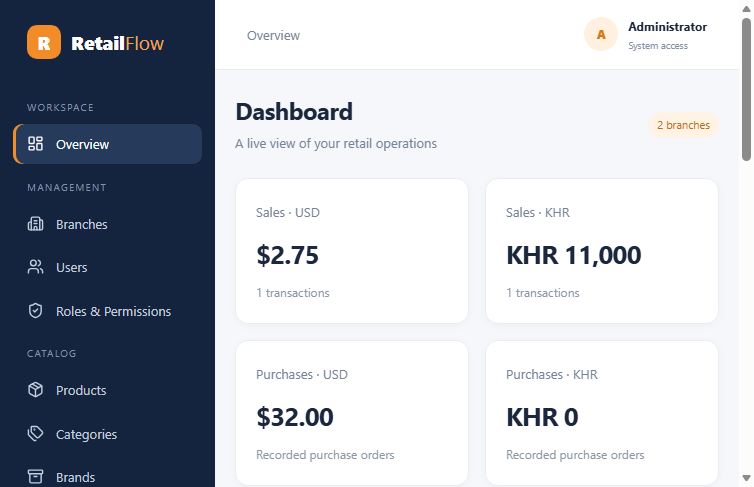

# Retail Management System V1

A multi-branch retail operations application with a React dashboard and a Spring Boot REST API backed by PostgreSQL. V1 focuses on the core catalog, stock, sales, purchasing, and reporting workflows.

## Technology stack

- Java 25 and Spring Boot 4.0.0
- Maven Wrapper
- React, Vite, and JavaScript
- PostgreSQL 18 with Flyway migrations
- Spring Security, BCrypt password hashing, and revocable bearer sessions

## Features and modules

- Dashboard with USD/KHR totals, trends, branch performance, and low-stock count
- Login/logout, users, role assignment, and branch assignment
- Branches, products, categories, brands, units, customers, and suppliers
- Separate USD and KHR product prices
- Central and branch stock balances, adjustments, and stock transfers
- POS sales, invoices, server-side pricing, and refund APIs
- Purchase orders and partial goods receiving
- Summary reports and audit events

The UI covers the main V1 workflows. Some management endpoints are API-only or support creation/listing without full edit and status controls; see [V1 limitations](#v1-limitations).

## Architecture overview

```text
React + Vite browser
        │ /api/v1 (Vite development proxy)
        ▼
Spring Boot REST API ── Spring Security / bearer sessions
        │
        ├── Domain packages: auth, branches, catalog, users, inventory, sales, purchases, transfers, dashboard, finance
        ├── Flyway migrations and Hibernate schema validation
        ▼
PostgreSQL 18
```

The backend is organized by business domain, with shared API, audit, and security code under `common`. It uses JDBC for most API workflows and Spring Data JPA for branch persistence. Flyway owns schema changes; Hibernate runs with `ddl-auto: validate`. Sale, receipt, transfer, and inventory mutations use database transactions. Monetary values use PostgreSQL `NUMERIC` and Java `BigDecimal`; USD and KHR totals are reported separately. Authentication tokens are stored in browser `sessionStorage` and persisted server-side as hashes so logout can revoke them.

## Requirements

- Java 25
- Node.js 22.12 or newer and npm
- Docker Compose with PostgreSQL 18, or a PostgreSQL 18 instance you manage
- Network access on first Maven/npm dependency installation

## Database setup

1. Copy the root environment template and replace its placeholder values:

   ```powershell
   Copy-Item .env.example .env
   ```

   ```sh
   cp .env.example .env
   ```

2. Set a local database password and a unique initial administrator password in `.env`. Use a password manager or secure random generator; use at least 20 random characters for the administrator password. Never commit or share `.env`.
3. Start the local PostgreSQL 18 service:

   ```sh
   docker compose up -d postgres
   ```

   The Compose service uses the root `.env` values. Its named volume preserves database files between restarts. For a separately managed PostgreSQL server, set the connection values in `.env` instead.

On backend startup, Flyway applies pending migrations from `backend/src/main/resources/db/migration`. Do not use Hibernate schema update for database changes. The bootstrap administrator is created only when the users table is empty; changing `ADMIN_PASSWORD` after that does not rotate an existing account.

## Environment variables

Spring Boot imports the optional repository-root `.env` as properties when the backend starts from the `backend` directory. Operating-system environment variables take precedence. The following values are supported:

| Variable | Purpose | Value to configure |
|---|---|---|
| `DATABASE_URL` | PostgreSQL JDBC URL | `<jdbc:postgresql://host:5432/database>` |
| `DATABASE_USERNAME` | Database login | `<local-database-user>` |
| `DATABASE_PASSWORD` | Database password | `<local-database-password>` |
| `ADMIN_USERNAME` | Initial administrator username | `<initial-admin-username>` |
| `ADMIN_PASSWORD` | Initial administrator password, required for a fresh database | `<unique-random-secret-at-least-12-characters>` |
| `PORT` | Backend HTTP port | `<port-number; default 8080>` |

Do not put credentials in frontend variables. The frontend uses the Vite development proxy for `/api`; there is no frontend API secret. The `.env.example` files are templates only. Replace blank values locally before startup.

## Backend setup

From the repository root:

```powershell
cd backend
..\mvnw.cmd spring-boot:run
```

On macOS/Linux:

```sh
cd backend
../mvnw spring-boot:run
```

The API listens on port 8080 by default. Health endpoint: `GET http://localhost:8080/api/v1/health`. API details are in [docs/API.md](docs/API.md); schema notes are in [docs/DATABASE.md](docs/DATABASE.md).

## Frontend setup

In a second terminal, from the repository root:

```sh
cd frontend
npm ci
npm run dev
```

Open the local Vite URL printed by the command (normally `http://localhost:5173`). Vite proxies `/api` to `http://localhost:8080` during development.

## Cloud deployment preparation

The repository includes a root-context Java 25 multi-stage [Dockerfile](Dockerfile), a [.dockerignore](.dockerignore) that excludes local environment files and generated content, and a [Vercel configuration](frontend/vercel.mjs) for same-origin API proxying. No cloud resources are created by this repository configuration.

### Render backend

Create a Render **Web Service** from this repository with these settings:

| Setting | Value |
|---|---|
| Runtime | Docker |
| Root Directory | Leave unset (repository root) |
| Dockerfile Path | `./Dockerfile` |
| Docker Build Context | `.` (repository root) |
| Docker Command | Leave blank; use the Dockerfile entry point |
| Health Check Path | `/api/v1/health` |
| Port | Set `PORT` to Render's web-service port, normally `10000` |

Configure the Render service and managed PostgreSQL in the same region. Set `DATABASE_URL` to a JDBC URL built from the database's **internal** host and database name, for example `jdbc:postgresql://<internal-host>:5432/<database>?sslmode=require`; the Render dashboard's `postgres://` URI is not itself a JDBC URL. Set the username and password as separate environment variables. For a database outside Render, use its external hostname and require TLS with `sslmode=require`.

For a new, empty database, set `ADMIN_PASSWORD` to a unique random value of at least 12 characters (20+ recommended) before the first start. Bootstrap creates the initial administrator only if the users table is empty; it does not rotate an existing account. Flyway applies migrations during application startup, and Hibernate validates the migrated schema. Do not configure Hibernate schema updates.

The public health endpoint checks `SELECT 1` against PostgreSQL, so Render marks the service unhealthy if the database becomes unavailable. The endpoint is unauthenticated for platform probes and returns no connection details.

### Vercel frontend

Create a Vercel project connected to this repository with these settings:

| Setting | Value |
|---|---|
| Root Directory | `frontend` |
| Framework Preset | Vite |
| Install Command | `npm ci` |
| Build Command | `npm run build` |
| Output Directory | `dist` |

Set `RENDER_BACKEND_URL` in the Vercel build environment to the HTTPS origin of the Render backend (origin only; no path or trailing slash). The Vercel config forwards `/api/*` requests to that backend and serves other routes from the Vite SPA. The browser continues to request relative `/api` URLs, so production requests remain same-origin and do not require permissive CORS. Local Vite development continues to proxy `/api` to `http://localhost:8080`.

The backend does not currently configure CORS for direct cross-origin browser access. Use the Vercel proxy path for the frontend; if a future client calls the Render origin directly from a browser, configure a narrow origin allowlist first.

## Tests and production build

Backend tests (Java 25):

```powershell
cd backend
..\mvnw.cmd clean test
```

Frontend tests and production build:

```sh
cd frontend
npm test -- --run
npm run build
```

The PostgreSQL inventory integration tests are opt-in with `RMS_POSTGRES_TESTS=true`. Run them only with a newly created, dedicated test schema and an isolated test database connection. Set `SPRING_DATASOURCE_URL` to include that schema as `currentSchema`, set `SPRING_FLYWAY_SCHEMAS` and `SPRING_FLYWAY_DEFAULT_SCHEMA` to the same schema, and set a test-only `ADMIN_USERNAME`/`ADMIN_PASSWORD` for the bootstrap fixture. Then run:

```powershell
$env:RMS_POSTGRES_TESTS = 'true'
..\mvnw.cmd -Dtest=PostgresInventoryAdjustmentIntegrationTest test
```

These tests write fixture rows and intentionally do not clean them up. Do not point them at a shared, production, or important development schema. Never drop or reset a schema to clean test data.

## Screenshots

Dashboard captured with isolated functional-test data:



## V1 limitations

- Category, brand, and unit editing/status management is not implemented; current workflows create and list these records.
- User creation and enable/disable are available in the UI, but user edits and role/branch reassignment controls are not. Reassignment endpoints exist in the API.
- Customer and supplier UI/API flows cover creation and listing; update and status workflows are absent.
- Roles and permissions are view-only; permission administration is not implemented.
- Inventory adjustments are offered for existing balance rows. A new branch balance is normally initialized by receiving a stock transfer; there is no dedicated opening-stock UI.
- Reports are summary views. Invoice PDF/export, broad analytics, tax/VAT calculation, and barcode-device integration are outside V1.
- Refund request/approval endpoints exist, but there is no refund UI or payment-provider/tender reversal integration.
- Browser tokens are held in `sessionStorage`; production deployment should add a documented threat model and appropriate browser security controls.

## Portfolio/demo data

Use synthetic data only. Keep local environment files, test databases, credentials, tokens, and production data out of the repository and screenshots. Do not commit or publish without reviewing the working tree and generated artifacts.
